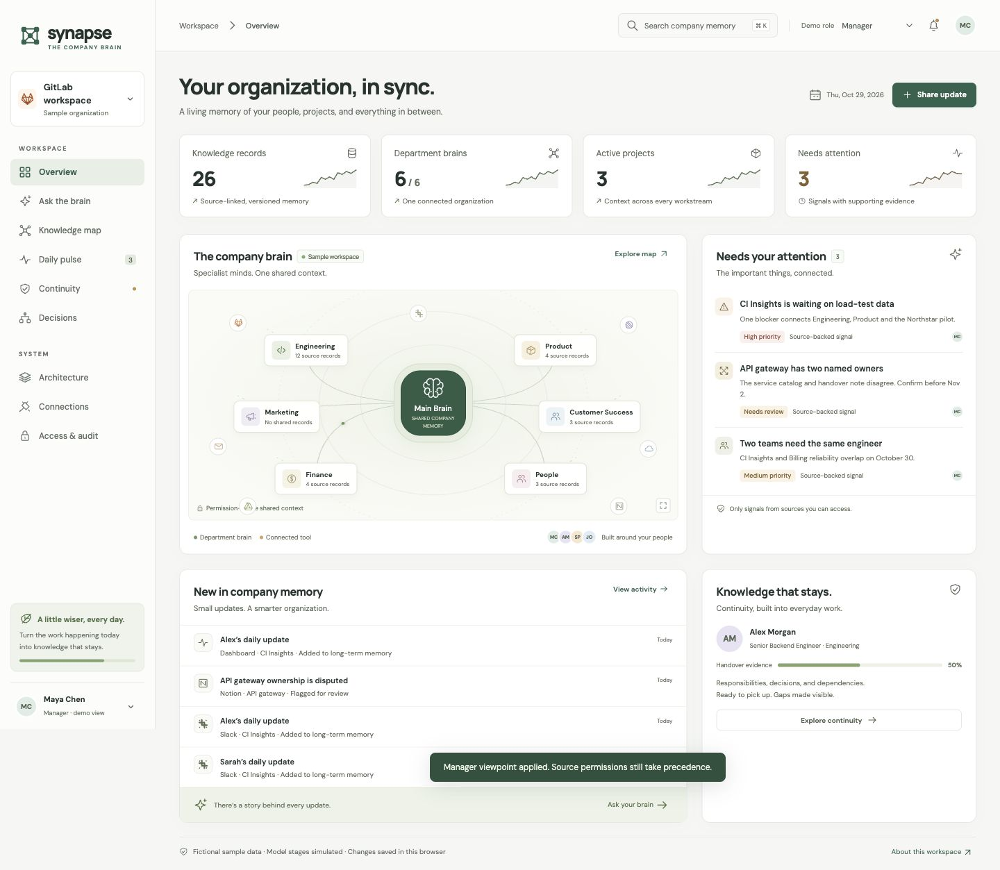
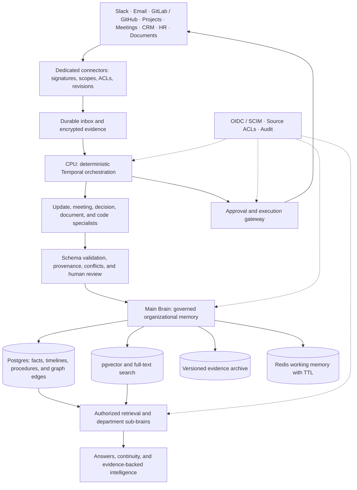

# Synapse — Company Brain

A connected organizational memory for the people, projects, decisions, and processes that keep a company moving.

Synapse explores how an organization can preserve the context behind its work: what happened, why a decision was made, who owns the next step, and which teams depend on it. This repository contains a working browser prototype and a researched architecture for building the production system.

> [!IMPORTANT]
> **Current status: interactive prototype and production blueprint.** Model processing uses deterministic local rules. No live LLM, workplace connector, server database, or enterprise authentication is implemented. All sample records are delivered to the browser; the role switcher demonstrates policy behavior and is **not a security boundary**. Use fictional data only.

The real-company reference is [GitLab’s public communication handbook](https://handbook.gitlab.com/handbook/communication/), particularly its documented, asynchronous approach to work. The employees, customers, projects, decisions, and operational scenarios here are fictional. This is an independent design, not a description of GitLab’s internal systems.



## What you can use today

| Area | Implemented in the prototype |
| --- | --- |
| Company overview | Department topology, visible record counts, attention signals, and recent knowledge |
| Knowledge map | Department and record-type filters, keyword search, source snapshots, and linked records |
| Ask the brain | Deterministic retrieval, extractive summaries, source references, and abstention when evidence is unavailable |
| Daily pulse | Completed work, current work, priorities, blockers, dependencies, and a visible processing journey |
| Human review | Self-reports stay distinct from reviewed records; an author cannot review their own update |
| Decision memory | Documented rationale, history, and conflicting ownership evidence preserved for review |
| Continuity | Responsibilities, decisions, dependencies, knowledge gaps, and downloadable handovers |
| Approval flow | Department-scoped successor proposals with a separate reviewer and evidence snapshot checks |
| Expertise inspection | Documented contributions and suggested work areas, without performance scoring |
| Impact scenarios | A bounded dependency scenario with explicit assumptions and an adjustable hypothetical delay |
| Connector inspection | Proposed scopes and event pipelines for Slack, GitLab, GitHub, Linear, documents, meetings, CRM, and HR |
| Access and audit | Five simulated roles, source-grant filtering, and local audit views separated by persona |

Changes persist in this browser using `localStorage`. Connector controls affect the simulation only. Approving a proposal does not reassign external tasks, send messages, or transfer permissions.

## Run locally

Requirements: **Python 3** to serve the app and **Node.js 20 or newer** to run its tests. There are no npm dependencies and no build step.

```sh
git clone https://github.com/solmyst/Ai-brain.git
cd Ai-brain
python3 -m http.server 4173 --directory dist
```

Open [http://localhost:4173](http://localhost:4173). Serve the files over HTTP because the application uses JavaScript ES modules.

In another terminal, from the repository root:

```sh
node --test tests/domain.test.mjs
node --check dist/app.js
node --check dist/domain.mjs
```

The [hosted instance](https://synapse-company-brain-ag.pinkspoon1025.chatgpt.site) is owner-private and requires the owner’s ChatGPT account. Running locally is the reproducible way to explore the project.

## Try the complete information journey

1. **Submit an employee update.** Select **Employee**, choose **Share update**, use the sample, and submit. The example links Alex Morgan’s CI Insights work to a load-test dependency.
2. **Inspect processing.** The visible stages capture attribution, structure the five fields, propose project links, check evidence, and retain the original report. These stages are simulated; the record remains self-reported.
3. **Review separately.** Switch to **Manager**, open **Daily pulse**, and review Alex’s update. Attestation records a different authorized reviewer; it does not independently prove every claim.
4. **Retrieve the reasoning.** Ask **Why is CI Insights delayed?** Open the source references to inspect the performance blocker and staged-rollout rationale.
5. **Inspect disagreement.** Ask **Who owns the API gateway?** The service catalog and draft handover name different owners. Both sources remain visible; the prototype does not invent a resolution.
6. **Change the permission viewpoint.** Switch to **Administrator** and enter the gateway question. Retrieval abstains because those Engineering sources are outside this persona’s simulated source grants.
7. **Reconstruct a handover.** Return to **Manager** and open **Continuity** for Alex. Inspect responsibilities, decisions, dependencies, and missing evidence, then export the packet.
8. **Separate request and approval.** Propose a successor plan as **Manager**, then switch to **Department head** to approve it. The requester cannot approve their own proposal, and no external action executes.
9. **Explore an impact scenario.** On the overview, open the CI Insights blocker and select **Explore impact scenario**. Adjust the hypothetical delay and inspect the Engineering → Product → customer-pilot dependency chain.
10. **Inspect documented expertise.** Open a source record and select its owner to see the contributions behind suggested work areas.

Use **About this workspace → Reset local demo** to restore the original fictional dataset. Changes are local to the browser and origin; separate browsers do not share updates.

## Production architecture

The proposed Main Brain is a governed memory and retrieval service. The CPU is a deterministic control plane that routes bounded model tasks, enforces policy, handles retries, and coordinates approvals.



Specialists propose structured claims with evidence references. Source policy, validation, and accountable reviewers determine what becomes accepted knowledge. Model output cannot grant access or approve its own actions.

### Recommended production stack

| Layer | Proposed technology |
| --- | --- |
| User interface | React / TypeScript and a Slack interface |
| API and extraction workers | FastAPI, Pydantic, SQLAlchemy, and versioned model adapters |
| Durable processing | Temporal with a managed queue such as SQS |
| Persistent memory | PostgreSQL, pgvector, full-text search, and typed relationship tables |
| Evidence archive | Encrypted S3-compatible object storage with versioning and retention |
| Short-lived context | Redis with TTL and authorization-scoped cache keys |
| Identity and authorization | Existing OIDC identity provider, SCIM lifecycle, OpenFGA, and source ACL checks |
| Operations | OpenTelemetry, a secrets manager, redacted telemetry, and protected audit storage |

Start with a modular service and one relational store. Add dedicated graph or event-stream infrastructure after measurements justify it. This stack is a production recommendation; the current prototype is plain HTML, CSS, and JavaScript.

### Four connected memory systems

- **Working memory:** short-lived request and session context, bounded by identity, purpose, and TTL.
- **Long-term organizational memory:** evidence-backed facts and relationships between people, projects, tasks, decisions, customers, and dependencies.
- **Procedural memory:** reviewed runbooks and workflows with owners, preconditions, and approval requirements.
- **Historical memory:** source revisions, decision rationale, alternatives, supersession, and both effective and recorded time.

A source update creates new context rather than silently erasing earlier reasoning. Contradictions require resolution, and the system must distinguish observations, proposals, accepted claims, and predictions.

### Permissions follow the evidence

Production authorization combines role scope with tenant isolation, source permissions, classification, and current policy. Executive and administrator roles do not automatically bypass confidential source access.

Derived summaries must respect every source they depend on. Authorization applies before model access and again before returning citations, graph relationships, handover exports, or approved actions. Revocation and deletion must propagate to facts, embeddings, relationships, and cached summaries.

Continuity preserves authorized organizational records when a person leaves. It cannot recover unrecorded expertise or grant a successor access to private material. A useful handover explicitly shows evidence freshness, disputed ownership, and missing knowledge.

## Documentation and implementation foundations

| Document | Contents |
| --- | --- |
| [Technical architecture](dist/docs/COMPANY_BRAIN_ARCHITECTURE.md) | Components, diagrams, information journey, data model, permissions, model routing, and cost assumptions |
| [Implementation roadmap](dist/docs/IMPLEMENTATION_ROADMAP.md) | Incremental delivery phases, owners, acceptance gates, and production rollout requirements |
| [Database foundation](dist/docs/schema.sql) | PostgreSQL / pgvector schema, tenant relationships, provenance, temporal records, and default-deny RLS |
| [API contract](dist/docs/openapi.yaml) | Proposed update, job, retrieval, graph, continuity, approval, and webhook interfaces |
| [Research notes](dist/docs/RESEARCH_NOTES.md) | Primary sources and independent architecture and security research |
| [Validation report](dist/docs/VALIDATION.md) | Tested behavior, verification methods, and explicit limitations |
| [Scope specification](SPEC.md) | Capability map, acceptance criteria, and prototype boundaries |

The SQL and OpenAPI files are implementation foundations. They do not represent a deployed backend, and the schema needs reviewed application roles and write policies before use with real data.

## Repository layout

```text
.
├── README.md
├── SPEC.md
├── dist/                         # Hand-authored application source; no build output
│   ├── index.html                # Page shell and metadata
│   ├── styles.css                # Responsive layout and visual system
│   ├── domain.mjs                # Sample records, policy, retrieval, review, continuity
│   ├── app.js                    # Interface, local state, dialogs, and workflows
│   └── docs/                     # Architecture, API, SQL, research, and preview assets
├── tests/
│   └── domain.test.mjs            # Node built-in test runner
└── tasks/
    └── plan.md                   # Implementation sequence
```

`dist/` is the source directory in this buildless application and is intentionally tracked. Preserve `dist/docs/` when serving the app: its document downloads use those paths.

## Validation

- **13 domain tests pass**, covering source filtering, restricted HR access, administrator boundaries, grounded retrieval and abstention, contradiction retention, update validation, separate reviewers, deletion tombstones, handover scope, audit visibility, and IST date handling.
- Both application JavaScript files pass Node syntax checks.
- Browser checks covered the employee-to-reviewer journey, conflicting evidence, role changes, successor approval, exports, and hypothetical impact scenarios.
- Main screens were checked at 1440px desktop and 390px mobile widths, including overflow, focus, and targeted text-contrast checks.
- **60 PostgreSQL statements parsed** and the **OpenAPI 3.1 contract validated across 11 paths**. These checks establish syntax and contract validity; no live database migration, policy integration, or backend service was tested.

Counts and risk signals come from the visible sample records. Sparklines are illustrative graphics, and scenario dates follow stated assumptions rather than a measured predictive model.

## Next implementation steps

1. Establish server identity, tenant boundaries, source authorization, and retention rules.
2. Pilot read-only Slack and project-tool ingestion with signed webhooks, durable capture, deduplication, reconciliation, and ACL/deletion propagation.
3. Add provider-approved model routing, structured extraction, evaluation datasets, provenance checks, and human review queues.
4. Implement persistent memory, authorized hybrid retrieval, bitemporal claims, and contradiction resolution.
5. Validate continuity packets, source freshness, successor acceptance, and department sub-brains.
6. Enable sensitive actions only after exact-plan approvals, execution-time policy checks, idempotency, and audit behavior are proven.

The [roadmap](dist/docs/IMPLEMENTATION_ROADMAP.md) defines the detailed security, reliability, and operational gates for each phase.
