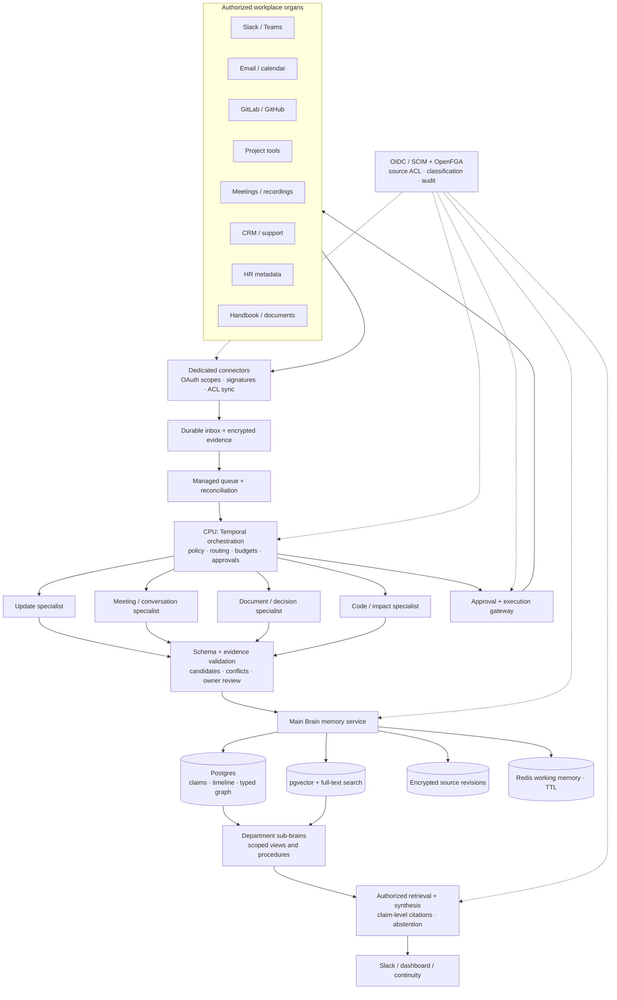

# Company Brain — production architecture

Research and design: 29 October 2026. Reference company: GitLab. All operational people, projects, decisions, customer examples, employment scenarios, and metrics in the accompanying prototype are fictional. This is an independent proposed system, not a description of GitLab's internal architecture.

## What is built and what is designed

The accompanying website is an interactive browser demonstrator. Its sample workspace, daily-update processing, role switching, evidence search, continuity packets, and approval flows run locally in the browser. It has no live enterprise connectors, production authentication, server database, or live model inference. All sample records are present in the client; role switching demonstrates intended behavior and is **not a security boundary**. Do not enter confidential company information.

This document, `schema.sql`, `openapi.yaml`, and `IMPLEMENTATION_ROADMAP.md` define the production implementation. The SQL is a foundation migration and the OpenAPI file is a proposed contract; neither constitutes a deployed backend. Production launch requires the implementation and security gates in the roadmap.

## Design premise

The Main Brain is a permission-aware memory and retrieval service, not one omniscient LLM. The CPU is deterministic orchestration code, not an agent permitted to choose its own authority. Specialized models propose structured observations; evidence checks, policy, and accountable humans decide what becomes accepted organizational knowledge.

GitLab is a useful reference because its public handbook describes a handbook-first working style. Keep canonical ownership in the source tools and link decisions back to their durable home. The Brain adds relationships, discovery, context, and continuity rather than creating an unowned competing source of truth. [GitLab handbook usage](https://handbook.gitlab.com/handbook/about/handbook-usage/)

“Never lost” means authorized institutional knowledge survives changes in employment, subject to retention and deletion requirements. No system can recover tacit expertise that was never captured, guarantee complete source delivery, or retain every personal communication indefinitely.

## Capability map and component responsibilities

| Component | Responsibility | Authority boundary |
|---|---|---|
| Connectors — sensory organs | Incremental capture, backfill, ACL/deletion sync, source revisions, delivery reconciliation | Installation scopes and source-object permissions |
| Identity and policy | OIDC sessions, SCIM lifecycle, roles, group membership, classification, purpose, OpenFGA checks | Server-derived identity; fail closed on stale policy |
| CPU / orchestrator | Durable jobs, routing, validation, budgets, retries, approvals, projection updates | Deterministic state machine; capability-limited activities |
| Specialists | Extract updates, meeting actions, conversation decisions, documents, code effects | Structured candidates with exact evidence spans |
| Main Brain | Entities, claims, rationale, procedures, history, permission-aware retrieval | No unrestricted global summary |
| Department sub-brains | Engineering, Product, Sales, Customer Success, People, Finance scopes and taxonomies | Shared provenance model; bounded retrieval views |
| Intelligence | Blocker/deadline rules, conflict review, expertise suggestions, change-impact scenarios | Evidence-backed alerts; predictions labeled hypotheses |
| Action gateway | Validated tool proposals, approval, execution, rollback evidence | Recheck authorization at execution; no arbitrary model tools |
| Dashboard / Slack interface | Updates, search, citations, graph, review, continuity | Same API/policy checks for every surface |

Build order: identity/policy → connectors/evidence → orchestration/extraction → memory/retrieval → continuity/intelligence → approved actions.

## Brain and organ architecture



The bidirectional loop is explicit: connectors observe source changes; the action gateway writes only approved commands through narrowly scoped connectors. A successful write returns a source revision and is ingested again, closing the loop without treating model output as source evidence.

## Recommended initial stack

| Layer | Choice | Why / when to revisit |
|---|---|---|
| User interface | React + TypeScript; Slack bot surface | Shared API and accessible review interactions |
| API / workers | Python FastAPI, Pydantic, SQLAlchemy; versioned model adapter | Typed contracts; reuse extraction and evaluation code |
| Durable workflow | Temporal; managed SQS-style queue for webhook buffering | Timers, retries, approval waits; no need for Kafka initially |
| Primary memory | Managed PostgreSQL + pgvector + full-text + typed edge tables | One transaction boundary and operational footprint |
| Source evidence | S3-compatible encrypted object storage; KMS; retention policies | Large evidence separate from query projections |
| Working memory | Redis with TTL and authorization-scoped keys | Disposable sessions/cache, never durable truth |
| Identity / authorization | Existing OIDC IdP, SCIM lifecycle; OpenFGA + policy module | Roles plus relationship/source access, not roles alone |
| Model execution | Provider-neutral capability router; approved hosted or private models | Region/classification restrictions; measurable quality/cost |
| Operations | OpenTelemetry; metrics/logs; secrets manager; infrastructure as code | Trace each event and action without exposing private prompts |

Use managed containers and managed databases in the organization's existing cloud. Add Kafka/Redpanda when replay/fan-out volume warrants it; add a dedicated graph engine only after Postgres traversals are measured bottlenecks. A graph projection is disposable and must preserve tenant, source ACL, and revision metadata.

## Information journey: daily update to organizational memory

Fictional update from Alex Morgan, Senior Backend Engineer: “Completed the composite-index benchmark on staging. Working on CI Insights query optimization. Next: run the 100k-pipeline load test with Noah. Blocked on anonymized load-test data from the platform team.” Maya Chen is the Engineering Manager; Sarah Park owns the launch checklist.

```mermaid
sequenceDiagram
  participant E as Employee / Slack
  participant C as Connector
  participant I as Inbox + Queue
  participant O as CPU / Temporal
  participant L as Update specialist
  participant P as Policy + evidence checks
  participant R as Reviewer
  participant B as Main Brain
  E->>C: Signed event + delivery ID
  C->>C: Verify raw signature, timestamp and installation
  C->>I: Durable unique delivery envelope
  C-->>E: Acknowledge promptly
  I->>O: Normalized event + source revision
  O->>P: Resolve identity, source access, allowed model route
  O->>L: Bounded evidence; schema and task only
  L-->>O: Completed/current/next/blocker/dependency candidates + spans
  O->>P: Validate fields, entities, citations and dates
  P-->>O: CI task matched; reported benchmark does not resolve latency gate
  O->>B: Store reported observation + task/dependency links
  O->>R: Review exact candidates and supporting revisions
  R->>O: Review benchmark evidence; retain rollout performance gate
  O->>B: Commit reviewed claim + graph + outbox atomically
  B-->>E: Authorized search, citations, outstanding load-test dependency
```

1. The connector verifies original bytes before parsing, maps the installed workspace to a tenant, and deduplicates by connector plus delivery ID. It persists an inbox record before acknowledging. Slack needs acknowledgement within three seconds; GitHub.com recommends ten seconds. LLM processing never blocks the webhook response. [Slack Events API](https://docs.slack.dev/apis/events-api/), [GitHub webhook best practices](https://docs.github.com/en/webhooks/using-webhooks/best-practices-for-using-webhooks)
2. Resolve source item/revision, event and observation timestamps, stable author ID, source URL, content hash, classification, ACL revision, and retention. Exclude unapproved DMs, secrets, and sensitive HR content by default. Verify Slack timestamps/replay windows and use timing-safe HMAC comparison. [Slack request verification](https://docs.slack.dev/authentication/verifying-requests-from-slack/)
3. Normalize first. Apply deterministic parsing/PII controls; coalesce conversation threads; route useful changed content to the smallest adequate extraction model. Calendar events yield scheduling observations, not proof that a meeting happened; an approved transcript yields possible actions and decisions.
4. The update specialist emits structured arrays and evidence offsets. Names without stable matches remain unresolved. A signed self-report proves who reported something, not that the business claim is true. Statuses are `observed`, `proposed`, `accepted`, `disputed`, `superseded`, `withdrawn`.
5. Validate schema, source span, entity reference, source revision, date semantics, and policy. Alex's update links to issue #2841: p95 query latency is 420 ms against a 250 ms target. The accepted ADR-042 authorizes a 10% rollout on November 3, replacing the full-launch proposal for October 30. The index benchmark and MR !187 do not prove the regression is resolved. An instruction inside a document is content, never a tool command.
6. Commit accepted claims and provenance plus an outbox row in one database transaction. Consumers update vector/lexical/graph projections idempotently. Keep raw evidence under retention controls, and preserve unresolved candidates separately from accepted knowledge.
7. Rules identify the anonymized-data blocker and downstream dependency on Sarah's launch checklist. A synthesis model may explain a risk using authorized evidence; only the owner can approve a proposed reschedule, and any external edit has a separate approval/execution boundary. Separately, the API gateway service catalog names Alex as primary owner while Noah's draft handover note names Noah. That is a disputed ownership claim for Maya to review; the Brain keeps both sources and does not choose by recency.

Webhook delivery is at least once, not magically exactly once. Temporal activities and external writes must be idempotent. GitHub does not automatically redeliver failed deliveries, so schedule delivery reconciliation and periodic source-state scans. Honor per-method/provider rate limits and retry-after responses. [Temporal activities](https://docs.temporal.io/activities), [GitHub failed deliveries](https://docs.github.com/en/webhooks/using-webhooks/handling-failed-webhook-deliveries), [Slack limits](https://docs.slack.dev/apis/web-api/rate-limits/)

## Memory model and database structure

| Memory | Store | Contents and lifecycle |
|---|---|---|
| Short term / working | Redis; job state in Temporal | Request context, bounded plan, recent authorized retrieval; minutes/hours TTL |
| Episodic | Inbox + versioned source objects | Messages, updates, meetings, code changes; effective time and learned time |
| Long-term / semantic | Postgres claims + pgvector/full-text | Accepted facts, entities, typed dependencies; evidence and owner required |
| Procedural | Versioned procedure resources | Reviewed runbooks, workflow definitions, preconditions, approval requirements |
| Historical | Claim/decision revisions + audit | What changed, rationale, alternatives, approver, supersession and reversals |

Core tables in `schema.sql`: `tenants`, `principals`, `role_bindings`, `connectors`, `inbox_events`, `resources`, `resource_read_grants`, `source_versions`, `chunks`, `claims`, `claim_evidence`, `edges`, `claim_conflicts`, `decisions`, `procedures`, `daily_updates`, `processing_jobs`, `continuity_snapshots`, `action_proposals`, `approval_decisions`, `audit_events`, `outbox_events`, and `purge_jobs`.

Resources are typed entities or claim/edge/procedure records with their own policy resource. Composite tenant foreign keys prevent cross-tenant references. Exact source-version spans, extraction/model/prompt versions, and owner review connect each accepted claim to evidence. Domain-specific attributes are JSON only where a connector's shape varies; canonical identity, timestamps, state, policy, and links are typed columns.

Bitemporal fields distinguish `valid_from/valid_to` (when the claim applied) from `recorded_from/recorded_to` (when the Brain believed it). Asking “What did we know on 10 October about the 15 October launch?” filters both timelines. Changes close a recorded interval and append a replacement revision; they never silently mutate history. Conflicts link competing claims for overlapping effective periods and a responsible reviewer. Accepted deadline changes can supersede earlier deadlines without representing a conflict.

The supplied schema is intentionally fail-closed: no public schema/table privileges and no application write policies. Provision a nonowner, nonsuperuser, `NOBYPASSRLS` API role, grant only required SELECT/EXECUTE, and set transaction-local tenant/subject context from the verified server session. Trusted ingestion/authorization writers require separately reviewed credentials and policies. Never hand this database connection to a browser. Postgres owners and `BYPASSRLS` roles have special behavior; `FORCE ROW LEVEL SECURITY` and role separation are essential. [Postgres RLS](https://www.postgresql.org/docs/current/ddl-rowsecurity.html)

## Retrieval and strict hierarchy

`allow = active identity ∧ same tenant ∧ permitted action/scope ∧ source access ∧ classification/purpose ∧ current policy ∧ not revoked`

| Role | Default action scope | Content access |
|---|---|---|
| Employee | Submit own update; query shared projects | Explicit source grants |
| Manager | Review direct-report updates; propose assignments | Team sources already shared with them |
| Department head | Department portfolio and approved cross-team reviews | Authorized department resources |
| Executive | Strategic questions and approved organization summaries | No automatic private HR/legal/security access |
| Administrator | Connector, identity and policy operations | No automatic business-content access |

Source grants always constrain role privileges. Emergency access is a separate expiring, reviewed, audited workflow. Agents act with `requester permissions ∩ specialist capability ∩ connector scope`; broad ingestion credentials never become query credentials.

Query pipeline: verified session → scope and classification filters → lexical/vector candidates → authoritative authorization → bounded graph expansion → reranking on allowed text only → synthesis → claim-level citation validation → authorization/ACL-epoch recheck before response. Return the same not-found shape for nonexistent and invisible resources. Do not reveal hidden titles, counts, graph degree, suggestions, or snippets. [OpenFGA RAG authorization](https://openfga.dev/docs/modeling/agents/rag-authorization), [permission-aware search](https://openfga.dev/docs/interacting/search-with-permissions)

A summary derived from source A and source B requires access to **both**. The authorization writer projects this intersection into `resource_read_grants`, including source dependency epochs; a reviewed sanitized summary is a distinct resource with explicit declassification history. Revoke the parent resource and all transitive projections before rebuilding them. A SQL grant index is defense-in-depth, not a substitute for authoritative checks.

Use exact search for small authorized sets and measure approximate recall under restrictive ACLs. pgvector's approximate filtering can return too few results; iterative scans or exact fallback improve recall while retaining authorization. [pgvector](https://github.com/pgvector/pgvector)

Fictional retrieval examples:

- Alex, an engineer, asks “Why is CI Insights blocked?” He receives the 420 ms versus 250 ms performance gate, anonymized-data dependency and cited issue; a private customer contract does not enter model context.
- Maya, his Engineering Manager, receives the same facts plus authorized team updates and can review the API gateway ownership disagreement. Management scope does not settle the conflict automatically.
- Elena, the department head, sees an approved dependency chain from Engineering performance validation to Product's launch checklist, not hidden People records.
- An executive sees a reviewed portfolio risk summary. An administrator sees connector lag and policy status. Neither gains unrestricted private content by seniority.

## Revocation, deletion, safety, and audit

ACL changes write a deny tombstone and increment the resource epoch first. Invalidate authorization-scoped caches, block affected projections, update OpenFGA/indexes, and rebuild derived grants. Recently changed or sensitive checks use higher-consistency policy reads; stale connectors exceed a configured ACL freshness budget and fail closed. Cached authorization can miss recent changes, so caching policy is explicit. [OpenFGA consistency](https://openfga.dev/docs/interacting/consistency)

Deletion tombstones evidence immediately, withdraws unsupported claims, removes chunks/vectors/edges/cached summaries, records per-store purge completion, and expires backups under the retention policy. Legal holds are explicit exceptions. The audit trail retains minimal non-content identifiers/hashes, action, actor/on-behalf-of, policy version, request ID, outcome, and timestamp; ship it to an access-controlled append-only sink. Protect logs and traces as sensitive systems.

Model-generated outputs and retrieved documents are untrusted. Tool calls pass strict schemas, allowlists, current authorization, budgets, and server-side execution policy; prompt filters are not a security boundary. [OWASP prompt-injection guidance](https://cheatsheetseries.owasp.org/cheatsheets/LLM_Prompt_Injection_Prevention_Cheat_Sheet.html)

Sensitive actions bind the exact plan hash, validated parameters, requester, distinct authorized approver, expiry, source target version, policy version, and idempotency key. Execution rechecks every condition. Changed plans require new approval. Outbound communications, HR/financial changes, permission changes, production deployment, and destructive deletion remain disabled until this path is proven.

## Organizational continuity

Verified offboarding triggers two independent workflows. First revoke sessions/tokens/delegations, remove groups, rotate person-owned integration credentials, stop scheduled actions, and preserve a stable person ID for attribution. A SCIM inactive flag triggers this explicit workflow rather than being assumed to revoke every session. [SCIM schema](https://www.rfc-editor.org/info/rfc7643/)

Then create an **authorized, as-of continuity draft** for an approved successor or manager. Traverse responsibilities → projects → open tasks → decisions/rationale → pending approvals → customers → dependencies → procedures → documented expertise. Every section carries source revisions, freshness, owner, acceptance state, and gaps. The successor accepts reassignment; the packet does not grant access to private correspondence.

Example packet for fictional Alex: CI Insights query optimization; the pending composite-index MR !187; the 100k-pipeline load test with Noah; the anonymized-data blocker; Sarah's launch-checklist dependency; ADR-042's accepted 10% rollout on November 3 and its 420 ms versus 250 ms rationale; service runbook v3; the API gateway certificate-rotation responsibility disputed between Alex's catalog entry and Noah's draft note; and the missing emergency rollback video. Maya must confirm accountable gateway ownership before reassignment. Coverage is `reviewed active responsibilities with current evidence / discovered active responsibilities`; the denominator and snapshot date are visible. It is not a claim that all of Alex's knowledge has been captured. Recheck permissions on every packet view and export.

## Beyond a chatbot

- **Sub-brains:** shared schema with department taxonomies, approved procedures, model routing policies, and access-filtered summaries. Cross-department questions expand through authorized dependencies rather than broadcasting raw content.
- **Expertise map:** evidence-backed contributions and opt-in verified skills, decayed by recency. Used to find a knowledgeable backup, not rank employees or infer performance from message volume.
- **Workflow discovery:** mine recurring authorized event sequences, propose a draft SOP with evidence, and ask the process owner to validate it. Never auto-install a workflow from correlation.
- **Decision memory:** retain problem, alternatives, rationale, DRI, evidence, effective date, approver, outcome, and reversal history. “Why” requires documented rationale; missing rationale is an explicit gap.
- **Organizational digital twin:** a versioned operational dependency graph. A scenario such as “delay Security review two days” propagates through declared hard dependencies, showing affected tasks and assumptions. Predictions are scenario estimates with uncertainty and validation, not certain causal facts or psychological replicas of employees.

## Model routing, cost, latency, and operational targets

| Route | Work | Escalation / control |
|---|---|---|
| Code only | Identity, ACL, dedup, dates, deadlines, budgets, approval, checksums | No model involvement |
| Small extraction model | Update fields, document labels, action/decision candidates | Escalate schema failure or evaluated ambiguity |
| Small embedding model | Changed authorized chunks | Batch; content-hash + model-version cache |
| Reasoning model | Complex cited synthesis, cross-team ambiguity, conflict explanation | Hard context/time/token budget; no permission decisions |
| Human review | Consequential facts, disputed claims, action approval | Exact evidence and proposed diff |

Specialists can share models; they need not be separate paid deployments. Use approved provider/region per classification, provider timeouts and circuit breakers, structured outputs, prompt/model versioning, bounded retries, and per-tenant spend caps. Cache only by tenant + subject authorization fingerprint + source revisions + prompt/model versions. Do not cache one universal answer.

Planning example, **not vendor pricing or achieved performance**: 1,000 employees × 50 authorized events/day = 50,000 events/day. Coalescing/dedup routes 10,000 useful items/day to extraction. At 800 input + 120 output tokens/item, this is 8M input + 1.2M output tokens/day. With assumed rates of $0.20/M input and $0.80/M output, extraction is $2.56/day. If 500 complex answers/day use 6,000 input + 700 output tokens at assumed $2/M and $8/M, synthesis is $8.80/day. Combined illustrative model subtotal: $11.36/day, about $341/30 days; exclude embeddings, transcription, retries, infrastructure, engineering and any private model hosting. Replace rates and event distributions with a measured provider quote before budgeting.

Proposed pilot SLOs: persistence/ack p95 <1 s, ordinary authorized search p95 <2 s, typical cited synthesis p95 <8 s, initial source-to-search p95 <60 s excluding provider throttling/backfill. Plan for 20× average event bursts; source quotas and document sizes can dominate. Measure connector lag, DLQ depth, duplicate rate, ACL freshness, purge lag, citation fidelity, unsupported-answer rate, extraction accuracy, token spend, continuity gaps, and approval execution outcomes. These are targets, not claims about the prototype.

## Interfaces and verification

`openapi.yaml` describes updates/jobs, search/answers, graph, continuity drafts, proposals/approvals, and signed webhook ingestion. API derives tenant and author from identity. `Idempotency-Key` binds request hash per tenant/subject/route; pagination tokens bind scope and policy epoch. Resource IDs are opaque, and cursors contain no hidden titles.

Before real data: prove cross-tenant isolation, source ACL inheritance, derived-source intersections, graph/count non-disclosure, revocation during generation, deletion across stores, forged/replayed webhooks, exactly-once *effects* under delivery retries, target-version approval checks, unsupported-answer abstention, worker restart recovery, continuity gaps, and backup restore. Detailed phased acceptance gates and operational ownership are in the roadmap.
